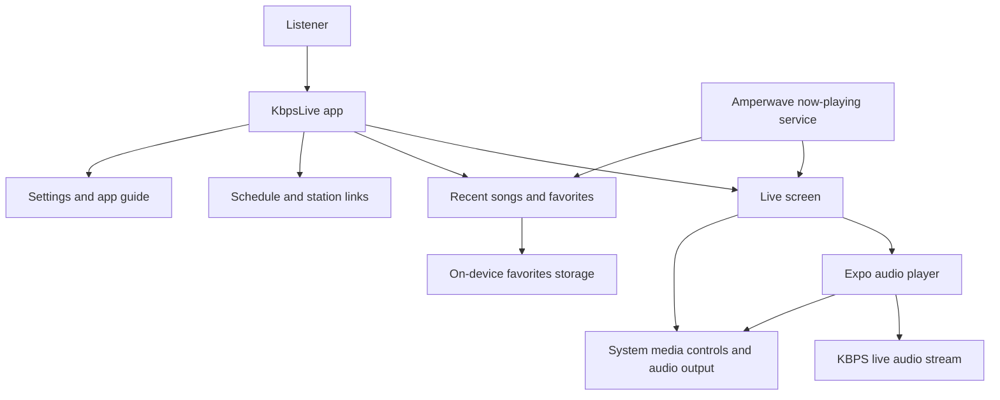

# KbpsLive

KbpsLive is a mobile app for listening to AM 1450 KBPS, the student radio station of Portland Public Schools. It brings the live broadcast, recently played songs, and station information together in one place.

## Why I made it

I started KbpsLive as a personal senior project for my high school computer science program, as a favor to the radio teacher. I continued working on the app after graduating in 2022.

## Features

- Listen to the live radio stream, including background playback.
- See the current song, artist, and artwork when available.
- Browse recently played songs and save favorites on the device.
- Explore the station schedule, news, interviews, and song request information.
- Choose an audio output with AirPlay on iOS and control playback through system media controls.

## How it works



The app is built with React Native, Expo, TypeScript, and Expo Router. The player uses Expo Audio, while the now-playing service supplies song information separately from the audio stream. On iOS, the operating system controls how Now Playing appears on the Lock Screen and Dynamic Island.

## Roadmap

- [CMS and admin plan](docs/CMS-PLAN.md): letting station staff edit station content without an app update.
- [Schedule CMS setup](docs/CMS-SETUP.md): configure the schedule backend and staff admin. Without configuration the app keeps its bundled schedule.

## Development

From this directory, install the project's dependencies and start Expo:

```sh
npm ci
npm start
```

The install runs `patch-package` to apply the native dependency patches used by the app. To build and run the native app, use `npm run ios` or `npm run android` with the appropriate platform development tools installed. The iOS native app and media controls require a native build, not Expo Go.

Run the test suite with:

```sh
npm test -- --runInBand
```
