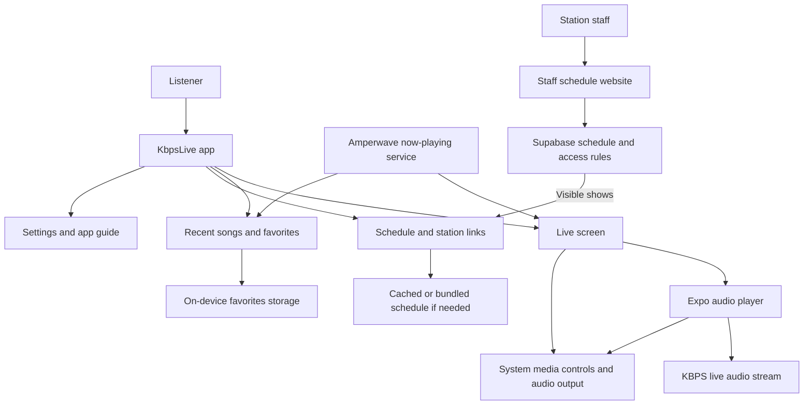
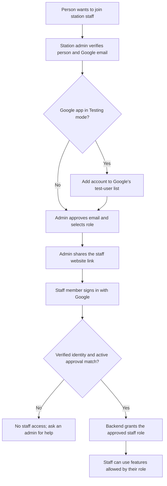
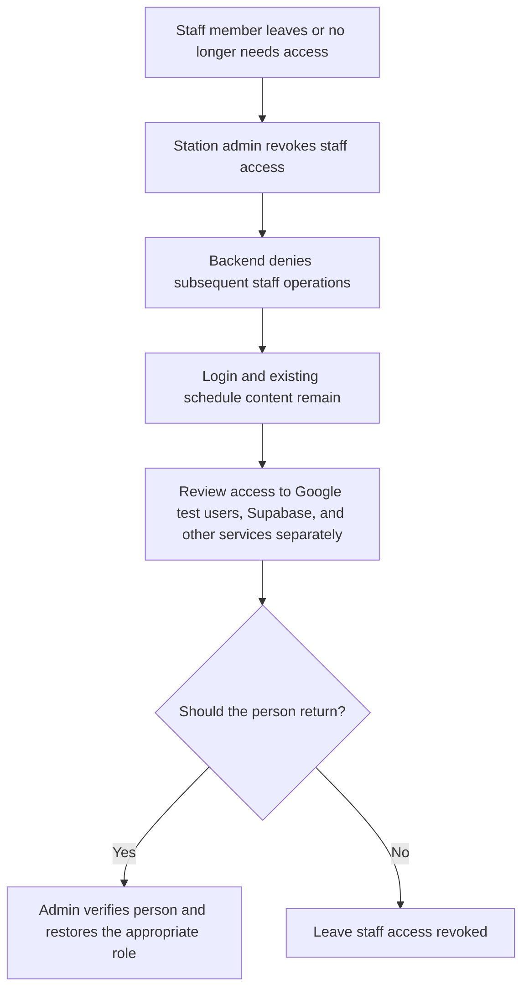

# KbpsLive

KbpsLive is a mobile app for listening to AM 1450 KBPS, the student radio station of Portland Public Schools. It brings the live broadcast, recently played songs, and station information together in one place.

## Why I made it

I started KbpsLive as a personal senior project for my high school computer science program, as a favor to the radio teacher. I continued working on the app after graduating in 2022.

## Features

- Listen to the live radio stream, including background playback.
- See the current song, artist, and artwork when available.
- Browse recently played songs and save favorites on the device.
- Explore the station schedule, news, interviews, and song request information.
- Choose an audio output with AirPlay on iOS and control playback through system media controls.

## How it works

The diagrams below explain how listeners receive station information and how the station can manage access. They are included to make the app easier to understand, operate, and hand over to future station staff or student developers.

### App and schedule flow



The app is built with React Native, Expo, TypeScript, and Expo Router. The player uses Expo Audio, while the now-playing service supplies song information separately from the audio stream. When configured, the iOS and Android apps fetch the visible schedule when Explore opens and refresh it while that screen remains open. A cached or bundled schedule provides a fallback. Updated app builds and end-to-end testing are needed before listeners can use the remote schedule. On iOS, the operating system controls how Now Playing appears on the Lock Screen and Dynamic Island.

### Staff onboarding

This flow shows the steps for giving a verified station member access without sending an invitation email. Approval is a station decision, not automatic: Google sign-in establishes identity, and the backend checks the verified identity and active staff approval before granting a role.



In the current Google Testing mode, adding someone to Google's test-user list and approving them on the station website are separate steps. New account creation also requires Supabase sign-ups to be enabled with the signup restriction hook active. Existing staff profiles and linked sign-in methods are managed separately; signing in alone does not grant staff access.

### Staff offboarding

This flow explains how the station can stop someone's editing access while preserving the station's content. It also highlights that access to other services must be reviewed separately.



Editors can add and edit shows, including making them visible; administrators can also delete shows and manage staff. There is no separate publishing approval queue. Project owners and service-role users have broader access than these website roles, so handoff should include reviewing service ownership and permissions.

## Roadmap

- [CMS and admin plan](docs/CMS-PLAN.md): letting station staff edit station content without an app update.
- [Schedule CMS setup](docs/CMS-SETUP.md): configure the schedule backend and staff admin. Without configuration the app keeps its bundled schedule.

## Development

From this directory, install the project's dependencies and start Expo:

```sh
npm ci
npm start
```

The install runs `patch-package` to apply the native dependency patches used by the app. To build and run the native app, use `npm run ios` or `npm run android` with the appropriate platform development tools installed. The iOS native app and media controls require a native build, not Expo Go.

Run the test suite with:

```sh
npm test -- --runInBand
```
